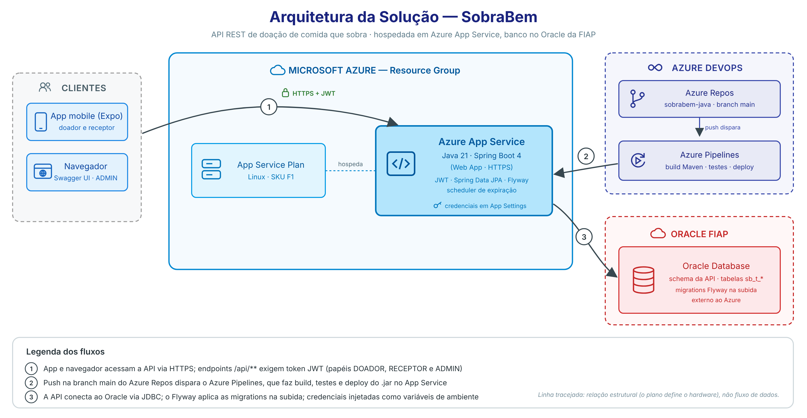

# SobraBem API - Doação de comida que sobra

API REST para conectar quem tem comida sobrando a quem precisa, desenvolvida em Java com Spring Boot, Maven, JPA/Hibernate e Oracle Database. Padarias, feiras e mercados publicam o que sobrou no fim do dia, com quantidade e horário limite de retirada; ONGs e famílias reservam uma parte e retiram no local com um código.

---

# Desenvolvido por

- Guilherme Cintra RM562850
- Erick de Faria Gama RM561951
- Matheus Nascimento Corregio RM563765
- Pedro Fonseca de Almeida RM563466
- Daniel Fonseca de Almeida RM563045

---


# Descrição do projeto

Todo fim de dia, pães, frutas e refeições prontas que ainda estão boas para consumo vão para o lixo, porque doar dá trabalho: o comércio não sabe quem precisa, e quem precisa não sabe onde tem comida disponível. O SobraBem resolve essa parte da coordenação.

A solução tem duas partes integradas: a API principal, desenvolvida em Java com Spring, que guarda os dados, aplica as regras de negócio e controla o acesso; e um aplicativo móvel, por onde doadores e receptores usam a plataforma no dia a dia.

A API é o núcleo da solução. Ela cuida do cadastro de usuários, da publicação de doações com prazo de retirada, das reservas com desconto de saldo e da confirmação da retirada pelo código. Cada usuário enxerga apenas o que lhe diz respeito: um doador só edita as próprias doações, um receptor só vê o código das próprias reservas, e nenhum dos dois acessa as funções de administração.

---

# Objetivo

A aplicação reduz o desperdício de alimentos e facilita a doação, permitindo:

- Cadastro e autenticação de doadores e receptores
- Publicação de doações com quantidade, categoria e prazo de retirada
- Reserva de parte de uma doação, com saldo atualizado na hora
- Confirmação da retirada com um código de 6 caracteres
- Expiração automática das doações e reservas vencidas

A API foi desenvolvida em arquitetura REST, com persistência em banco de dados Oracle.

---

# Benefícios

**Menos comida no lixo.** O comércio publica a sobra em segundos e ela chega a quem precisa no mesmo dia, em vez de ser descartada.

**Nada de reserva além do disponível.** O saldo é descontado no banco de forma atômica: dois receptores disputando a última unidade nunca conseguem reservar juntos mais do que existe.

**Prazo respeitado.** A API recusa reservas depois do horário limite e expira sozinha as doações vencidas, sem depender de ninguém lembrar.

**Retirada sem confusão.** O receptor mostra o código no balcão e o doador confirma no app; a doação fica registrada.

**Histórico centralizado.** Doações, reservas e retiradas ficam registradas no banco, disponíveis para doador, receptor e administração a qualquer momento.

---

# Arquitetura da Solução

## Visão geral

A solução segue um modelo de **aplicação monolítica hospedada em PaaS com banco de dados externo**. Não há infraestrutura de servidor sob nossa responsabilidade: o Azure App Service cuida do runtime Java e o Oracle guarda os dados. O que gerenciamos é o *código* e a *configuração*.



## Recursos utilizados

**Microsoft Azure**
- **Resource Group** — agrupa todos os recursos da solução
- **App Service Plan** — Linux, SKU F1 (free tier)
- **App Service (Web App)** — hospeda o `.jar` do Spring Boot, runtime Java 21

**Azure DevOps**
- **Azure Repos** — repositório Git do código-fonte
- **Azure Pipelines** — pipeline de CI/CD (build Maven, testes e deploy)

**Externos**
- **Oracle** — banco de dados da aplicação

> O banco **não** é provisionado pelo script de infraestrutura e **não** roda dentro do App Service. Ele já existe no Oracle da FIAP, e a aplicação se conecta a ele por JDBC, com credenciais injetadas como variáveis de ambiente. Destruir e recriar todo o ambiente Azure não afeta os dados.

## Camadas da aplicação

Dentro do App Service, a aplicação segue arquitetura em camadas: requisição HTTP → Spring Security (filtro JWT) → Controllers (`/api/**`) → Services → Repositories (Spring Data JPA) → Hibernate → Oracle Database. À parte, o Flyway aplica as migrations no banco a cada inicialização.

- **Spring Security** valida o token JWT antes de qualquer controller ser alcançado e aplica os papéis `DOADOR`, `RECEPTOR` e `ADMIN`; as rotas de autenticação e o Swagger ficam fora dessa exigência.
- **Controllers** expõem os endpoints REST e traduzem HTTP em chamadas de serviço, sem regra de negócio.
- **Services** concentram as regras: prazo de retirada por categoria, desconto atômico do saldo, uma reserva ativa por receptor, código de retirada e cancelamentos.
- **Repositories** abstraem o acesso ao banco via Spring Data JPA.
- **Scheduler** roda a cada 5 minutos e marca como expiradas as doações e reservas com prazo vencido.
- **Flyway** roda na subida da aplicação e garante que o schema do Oracle esteja na versão esperada pelo código. O deploy do `.jar` e a evolução do banco acontecem juntos, sem passo manual. O histórico fica em `sb_flyway_schema_history`.

---

# Fluxos de Funcionamento

## 1. Fluxo de acesso

Seta ① do diagrama: o app mobile e o navegador (Swagger) acessam a aplicação pela URL pública do App Service, sempre via HTTPS. As rotas `/api/**` exigem o token JWT obtido no login, exceto cadastro e login.

## 2. Fluxo de deploy (CI/CD)

Seta ② do diagrama. É o fluxo que caracteriza a esteira de DevOps: da alteração no código até a aplicação no ar, sem intervenção manual. O desenvolvedor faz `git push` na branch `main` do **Azure Repos** → o **Azure Pipelines** dispara automaticamente → roda o build Maven com os testes → publica o `.jar` no App Service → o App Service reinicia a aplicação → o Flyway valida/aplica as migrations no Oracle → a nova versão fica disponível na URL pública.

## 3. Fluxo de dados

Seta ③ do diagrama: a aplicação se conecta ao Oracle por JDBC. URL, usuário e senha do banco não estão no código; são lidos das variáveis de ambiente configuradas no App Service.

## Provisionamento inicial

Executado uma única vez, via `scripts/cria-infra.sh`:

1. Registra os providers do Azure utilizados na assinatura
2. Cria o Resource Group
3. Cria o App Service Plan (Linux, F1)
4. Cria o Web App com runtime Java 21
5. Configura as variáveis de ambiente da aplicação (banco, JWT e usuário ADMIN)
6. Reinicia o Web App para aplicar a configuração

A partir daí, um `git push` na branch `main` basta para publicar novas versões; o script não precisa ser executado de novo.

## Variáveis de ambiente

Configuradas em **App Service → Configuration → Application settings**. Nenhuma delas fica no repositório; o `.env.example` traz só os nomes.

| Variável | Para quê |
|---|---|
| `DB_URL`, `DB_USER`, `DB_PASSWORD` | conexão JDBC com o Oracle da FIAP |
| `JWT_SECRET` | assinatura dos tokens (32 caracteres ou mais) |
| `ADMIN_EMAIL`, `ADMIN_SENHA` | usuário ADMIN criado na primeira subida |

## Segurança e configuração

| Preocupação | Como é tratada |
|---|---|
| Credenciais do banco e segredo do JWT | Variáveis de ambiente no App Service, nunca no repositório |
| Tráfego externo | HTTPS fornecido pelo App Service |
| Acesso à API | Token JWT obrigatório nas rotas `/api/**`, com controle por papel |
| Senhas dos usuários | Guardadas com hash BCrypt |
| Credencial de deploy | Service Connection do Azure DevOps, que autoriza o Azure Pipelines a publicar no App Service |

---

# Como criar o Web App no Azure

O script de provisionamento está em **`scripts/cria-infra.sh`**.

## Pré-requisitos

- Azure CLI instalado e autenticado (`az login`)
- Permissão para criar recursos na assinatura do Azure
- Banco Oracle da FIAP já existente e acessível (o script **não** cria o banco)

## Passo a passo

**1. Entre na pasta do script**

```bash
cd scripts
```

**2. Dê permissão de execução e execute o script**

```bash
chmod +x cria-infra.sh
./cria-infra.sh
```

**3. Valide a aplicação**

```
https://<WEBAPP_NAME>.azurewebsites.net/swagger-ui.html
```

## Depois do primeiro deploy

- Todo push na branch `main` do Azure Repos dispara build e deploy pelo Azure Pipelines.
- Para trocar qualquer credencial, altere em **App Service → Configuration → Application settings**; o Web App reinicia sozinho.
- Para destruir todo o ambiente: `az group delete --name <RESOURCE_GROUP_NAME>`. O banco no Oracle da FIAP permanece intacto.